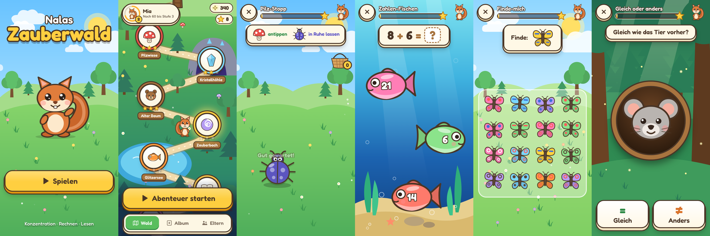

# 🐿️ Nalas Zauberwald

Ein Konzentrations- und Übungsspiel für Kinder in der **2. Klasse (Deutschschweiz)**, ca. 7–8 Jahre.
Gebaut als **PWA** (Progressive Web App = eine installierbare Webseite). Läuft offline,
speichert alles **nur lokal** auf dem Gerät – keine Werbung, keine Konten, keine Cloud.



## Was die App macht

Das Kind wandert mit Nala, dem Eichhörnchen, über eine **Weltkarte** durch den Zauberwald.
Jeder Ort ist ein Minispiel. Ein **Abenteuer** = 4 Orte nacheinander (ca. 10–15 Minuten),
gemischt aus Konzentrations-Training und **echtem Schulstoff** (Rechnen bis 100, Lesen).
Am Ende gibt es **einen** Sticker fürs Album.

### Die 8 Orte

| Ort | Spiel | Trainiert |
|-----|-------|-----------|
| Pilzwiese | Pilz-Stopp | Impulskontrolle (Go/No-Go) |
| Kristallhöhle | Kristall-Echo | Merken einer Reihenfolge (Corsi) |
| Alter Baum | Gleich oder anders | Arbeitsgedächtnis (1-back / 2-back) |
| Zauberbach | Sortier-Wirbel | Umdenken / Regelwechsel (DCCS) |
| Glitzersee | Zahlen-Fischen | **Rechnen bis 100** (Plus/Minus) |
| Lese-Lichtung | Wörter-Angel | **Lesen** (Sichtwortschatz) |
| Blumenwiese | Finde-mich | Selektive Aufmerksamkeit |
| Lagerfeuer | Tier-Geschichten | Zuhören und Merken |

Alle Spiele haben **adaptive Schwierigkeit**: richtig → etwas schwerer, falsch → etwas leichter.

### Grafik, Klang und Stimmung (Version 2.0)
- **Alle Bilder sind im Code gezeichnet** (SVG, `js/art.js`): Figuren, Tiere, Szenen, Karte.
  Keine Emojis, keine Bilddateien – sieht auf jedem Gerät gleich aus.
- **Animationen**: Nala blinzelt und jubelt, Funken und Konfetti (`js/fx.js`), weiche Übergänge.
- **Tageszeit**: Karte und Titelbild zeigen Morgen, Tag, Abend oder Nacht – passend zur Uhrzeit.
- **Naturklänge** (`js/music.js`): Vögel, Wind, Bach, Grillen, Eule, Wassertropfen, Lagerfeuer –
  je nach Ort. Dazu ruhige Marimba-Musik und weiche Spielklänge (`js/audio.js`).
  Alles wird im Gerät erzeugt (keine Tondateien) und ist im Eltern-Bereich abschaltbar.
- **Belohnung**: 1–3 Sterne pro Ort (mindestens 1 Stern gibt es immer), Lichtfunken, Stufen, Sticker.

### Gesundes Design (bewusst OHNE Suchtmechaniken)
- Keine Streaks, kein Zeitdruck-Alarm, keine Push-Nachrichten, keine Lootboxen.
- Klares Ende der Session. Lob für **Anstrengung**, nicht für Highscore.
- Fehlerfreundlich: ein Fehler gibt einen **sanften** Ton, nie einen Strafton.
- Grosse Buttons, wenig Text, Anweisungen werden **vorgelesen**.
- Schweizer Rechtschreibung: immer **«ss»**, nie «ß».

### Eltern-Bereich (PIN)
Standard-PIN: **1234** (im Eltern-Bereich änderbar). Zeigt Trainingszeit, geübte
Bereiche und Schwierigkeitsstufen – **ohne Ranking**, ohne Vergleich mit anderen Kindern.
Dort lassen sich Name, Spielklänge, Musik, Naturklänge, Vorlesen und PIN einstellen.

## Auf das Handy / Tablet bringen (ohne App-Store)

1. Dateien auf einen kleinen Webspace legen **oder** lokal einen Server starten:
   ```bash
   cd Konzentrationstool
   python3 -m http.server 8000
   ```
2. Im **Chrome** auf dem Gerät die Adresse öffnen (z. B. `http://<PC-IP>:8000`).
3. Menü → **«Zum Startbildschirm hinzufügen»**. Fertig – die App startet wie eine normale App
   und funktioniert danach auch offline.

> Hinweis: PWA braucht für die Installation normalerweise `https` oder `localhost`.
> Für den reinen Familiengebrauch reicht das Öffnen im Browser auch ohne Installation.

## Ehrliche Einordnung (wichtig)

- **Belegt:** Man wird in der geübten Aufgabe besser (near transfer).
- **Nicht belegt:** dass abstraktes «Gehirnjogging» allgemein klüger macht oder die
  Schulnoten verbessert (far transfer). Darum übt diese App **direkt Schulstoff**.
- Am wirksamsten sind ohnehin **Bewegung, Musik, Brettspiele und Vorlesen**.
  Die App ist ein kleiner, motivierender Baustein – kein Ersatz.
- Richtwert (Pro Juventute): max. **60 Min./Tag** Bildschirmzeit für 6–9-Jährige.

## Technik

Reines HTML/CSS/JavaScript, keine externen Bibliotheken. Struktur:

```
index.html            – Einstieg
css/style.css         – Aussehen und Animationen
fonts/                – Schriften (lokal, offline)
js/art.js             – alle Grafiken (SVG): Nala, Tiere, Dinge, Szenen, Weltkarte
js/audio.js           – Vorlesen + Spielklänge + Mischpult
js/music.js           – Musik und Naturstimmung
js/fx.js              – Funken, Konfetti, Übergänge
js/storage.js         – lokale Speicherung
js/geschichten.js     – Tier-Geschichten mit Zeichnungen
js/games.js           – die 8 Minispiele
js/app.js             – Bildschirme + Ablauf
manifest.webmanifest  – App-Installation
sw.js                 – Offline-Betrieb
icons/                – App-Symbole
tools/sync-www.sh     – kopiert die Web-App in die Android-/iOS-Hülle
```

Nach Änderungen an der Web-App `./tools/sync-www.sh` ausführen, damit Android und iOS
denselben Stand haben. Die APK baut danach die GitHub-Action «Android-APK bauen».
Die Dateien in `dist/` sind noch die alte Version 1.3.

Alle Daten bleiben auf dem Gerät (`localStorage`). Datensparsam nach revDSG.
